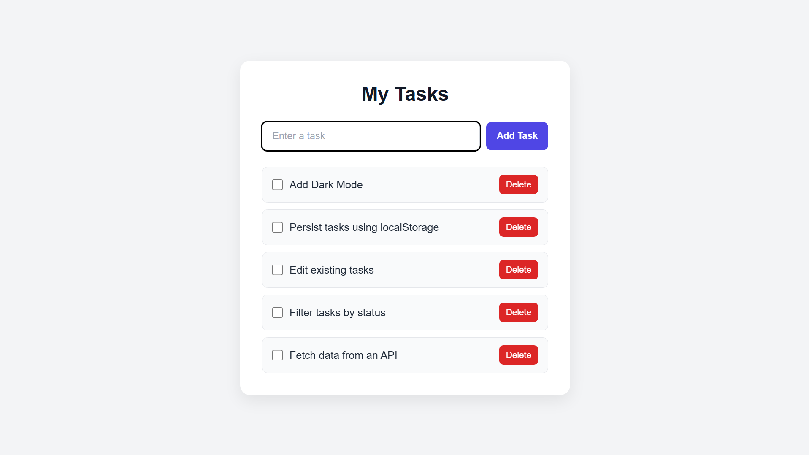

# To-Do List App

A beginner project built to learn and practice JavaScript through DOM manipulation and interactive web development.

## Preview

## Technologies
- HTML
- CSS
- JavaScript

## Getting Started

1. Clone this repository.
2. Open `index.html` in your browser.
3. Start adding and managing your tasks.

## JavaScript Concepts Practiced

- [x] Variables and data types
- [x] Functions
- [x] Arrays and objects
- [x] DOM manipulation
- [x] DOM events
- [ ] Asynchronous JavaScript
- [ ] Promises and async/await
- [ ] Fetch API
- [ ] Local storage

## Features
- Add tasks
- Mark tasks as completed
- Delete tasks

## Learning Goals
Build a functional web application while learning JavaScript fundamentals, browser APIs, and asynchronous programming.

## Future Improvements
- Add Dark Mode
- Persist tasks using localStorage
- Edit existing tasks
- Filter tasks by status
- Fetch data from an API

## What I Learned

Building this project helped me understand how JavaScript can be used to create interactive web applications.

Through this project, I practiced:

- **DOM Manipulation:** Selecting HTML elements and dynamically updating the webpage using JavaScript.
- **Event Handling:** Using event listeners to respond to user interactions, such as clicking buttons and checking checkboxes.
- **Functions:** Organizing code into reusable functions to handle different tasks.
- **Arrays and Objects:** Understanding how data can be represented and managed in JavaScript.
- **Dynamic UI Updates:** Adding new tasks to the webpage and removing existing ones without reloading the page.
- **Conditional Logic:** Updating the appearance of tasks when they are marked as completed.
- **HTML, CSS, and JavaScript Integration:** Connecting the webpage structure, styling, and behavior to build a functional application.

### Challenges I Worked On

- Handling user interactions through DOM events.
- Keeping the displayed task list synchronized with user actions.
- Applying different styles to completed tasks.
- Organizing the project into separate HTML, CSS, and JavaScript files.

### Key Takeaway

This project strengthened my understanding of JavaScript fundamentals and gave me practical experience building an interactive webpage. I plan to extend it with local storage, task editing, filtering, and other features as I continue learning JavaScript.