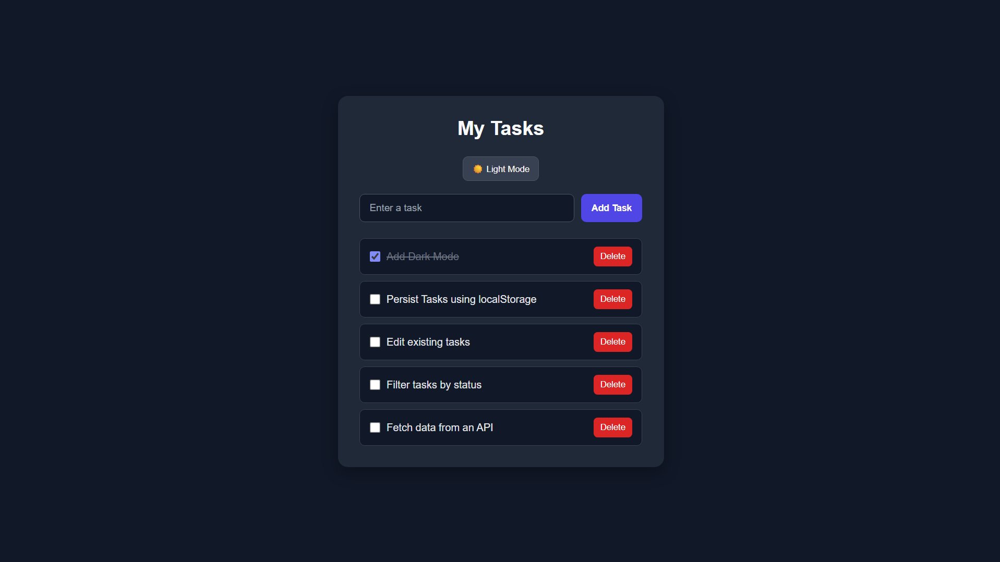

# To-Do List App

A beginner project built to learn and practice JavaScript through DOM manipulation and interactive web development.

## Preview

## Technologies
- HTML
- CSS
- JavaScript

## Getting Started
1. Clone this repository.
2. Open `index.html` in your browser.
3. Start adding and managing your tasks.

## Features
- Add new tasks
- Mark tasks as completed
- Delete tasks
- Visually distinguish completed tasks
- Toggle between dark mode and light mode

## JavaScript Concepts Practiced
- [x] Variables and data types
- [x] Functions
- [x] Arrays and objects
- [x] DOM manipulation
- [x] DOM events
- [x] Conditional logic
- [x] Dynamic UI updates
- [x] CSS class manipulation for theme switching
- [ ] Asynchronous JavaScript
- [ ] Promises and async/await
- [ ] Fetch API
- [ ] Local storage

## Learning Goals
Build a functional web application while learning JavaScript fundamentals, browser APIs, and asynchronous programming.

## What I Learned
Building this project helped me understand how JavaScript can be used to create interactive web applications.

Through this project, I practiced:

- **DOM Manipulation:** Selecting HTML elements and dynamically updating webpage content using JavaScript.
- **Event Handling:** Using event listeners to respond to user interactions, such as clicking buttons and checking checkboxes.
- **Functions:** Organizing code into reusable functions to handle different tasks.
- **Arrays and Objects:** Understanding how data can be represented and managed in JavaScript.
- **Dynamic UI Updates:** Adding new tasks and removing existing ones without reloading the page.
- **Conditional Logic:** Changing task styles when they are marked as completed.
- **Dark Mode:** Switching between dark and light themes by handling button clicks and updating CSS classes or styles.
- **HTML, CSS, and JavaScript Integration:** Connecting webpage structure, styling, and behavior to build a functional application.

## Challenges I Worked On

- Handling user interactions through DOM events.
- Keeping the displayed task list synchronized with user actions.
- Applying different styles to completed tasks.
- Implementing dark mode and light mode switching.
- Organizing the project into separate HTML, CSS, and JavaScript files.

## Future Improvements
- [ ] Persist tasks using `localStorage`
- [ ] Save the selected theme across page reloads
- [ ] Edit existing tasks
- [ ] Filter tasks by status (all, active, completed)
- [ ] Fetch data from an API
- [ ] Add asynchronous functionality using `async/await`

## Key Takeaway

This project strengthened my understanding of JavaScript fundamentals and gave me practical experience building an interactive webpage. Implementing dark mode also helped me understand how JavaScript can dynamically change the appearance of a webpage in response to user interactions.

I plan to extend the project with persistent storage, task editing, filtering, and API integration as I continue learning JavaScript.